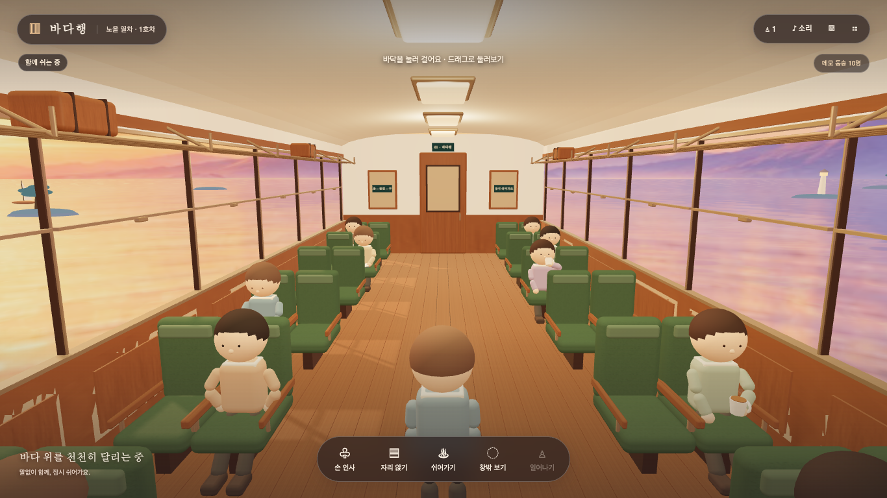

# 바다행 · Sea Train

[](https://github.com/khjn81/sea-train/actions/workflows/ci.yml)

바다 위를 달리는 기차에서 말없이 함께 쉬는 3D 웹 실험입니다. 차를 마시고, 책을 읽고, 창밖을 바라보며 다른 동승객에게 손을 흔들 수 있습니다.



[모바일 화면 보기](docs/train-mobile.png) · 브라우저 에뮬레이션

## 바로 실행

Node.js 22와 npm이 필요합니다. API 키나 계정 없이 실행합니다.

```bash
npm ci
npm run dev
```

<http://127.0.0.1:5173>를 엽니다. 이 명령이 화면과 실시간 서버를 함께 시작하고 종료합니다.

## 할 수 있는 일

- 빈자리에 걸어가 앉고, 차 마시기·책 읽기·기지개·휴식을 선택합니다.
- 자신의 자리 쪽 창밖을 보고 원래 시점으로 돌아옵니다.
- 실제 동승객의 이동·착석·행동과 손 인사가 공유됩니다.
- 데모 승객 10명과 실제 접속 인원은 따로 표시합니다. 연결이 끊기면 혼자 둘러볼 수 있습니다.
- 소리와 움직임 줄이기를 조절하고 현재 장면을 PNG로 저장합니다.

## 조작

| 입력 | 동작 |
| --- | --- |
| 바닥·좌석 클릭 | 걷기·착석 |
| 드래그·휠 | 둘러보기·거리 조절 |
| 화면 아래 버튼 | 인사·착석·휴식·창밖·일어나기 |
| 3D 화면에 포커스 후 방향키 / Enter | 걷기 / 가까운 빈자리에 앉기 |
| Escape | 메뉴 닫기·이동 취소·일어나기 |

소리는 기본 꺼짐입니다. 화면이 숨겨지면 렌더링과 소리가 쉬고, 복귀해도 소리는 자동 재생하지 않습니다.

## 빌드와 실행

```bash
npm run build
npm start
```

<http://127.0.0.1:3001>에서 빌드된 화면과 `/realtime` WebSocket을 한 서버가 제공합니다. 상태 확인은 `/healthz`입니다. 공개 호스팅 시에는 운영 환경에서 `HOST=0.0.0.0`과 `PORT`를 지정하고 HTTPS/WSS를 제공해야 합니다.

기본 방은 최대 24명이며 상태는 메모리에만 남습니다. `.env.example`은 선택 설정의 안내입니다. 환경 변수는 실행 환경에서 지정하며 별도 dotenv 로더는 사용하지 않습니다. 개발 포트는 `DEV_PORT`와 `REALTIME_PORT`로 바꿀 수 있습니다.

## 검증

```bash
npm test
npm run build
npx playwright install chromium webkit
npm run test:e2e
npm run test:release
npm run check:clean
```

E2E는 테스트용 브라우저 프로필에서 실제 화면과 WebSocket을 사용합니다. 공개 검증 명령은 Playwright에 고정된 전체 Chromium의 새 headless 모드를 사용합니다. WebKit은 별도 테스트 엔진입니다. 모바일 항목은 브라우저 에뮬레이션입니다.

22회 개선 과정, 실패 사례와 검증 범위는 [품질 기록](docs/quality.md), 평가 기준은 [루브릭](quality/rubric.json)을 참고하세요.

## 구조

- `src/`: 객실·바다·승객·행동·화면 및 복구 처리
- `server.js`, `server/`: 정적 빌드 제공과 실시간 방
- `tests/`: HTTP·프로토콜·프로세스·자원 수명 검사
- `e2e/`: 브라우저 여행·복구·접근성·자원 해제 검사

## 현재 범위

로컬 실행과 단일 서버 프로토타입을 다룹니다. 계정·영속 저장·여러 서버 간 방 공유는 없습니다. 실제 휴대폰의 장시간 발열·성능, 실제 사용자 만족도와 대규모 운영 부하는 검증하지 않았습니다.

원본 코드와 프로젝트 자산은 [MIT](LICENSE), 의존성과 자산 안내는 [THIRD_PARTY_NOTICES.md](THIRD_PARTY_NOTICES.md)를 따릅니다.
